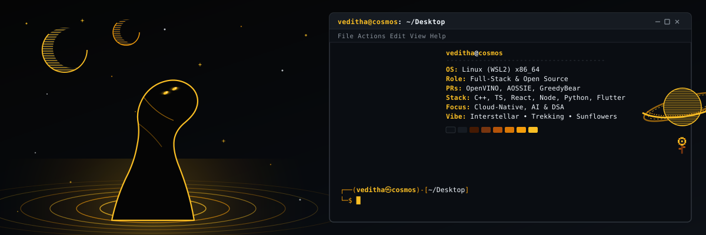
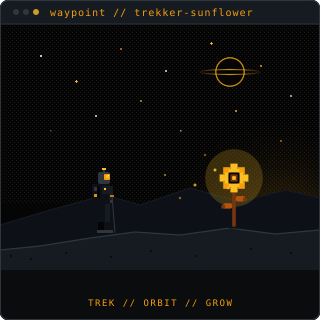
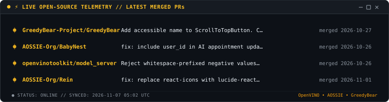

  

<h2 align="center">Hi 👋, I'm Veditha</h2>
<h4 align="center">Open-Source Contributor &amp; Developer</h4>

  

  Building reliable software, contributing to open-source, and chasing mountain trails.

 

### 🌻 About Me

Hi, I'm Veditha — an Information Technology student interested in software engineering, backend systems, and building things that solve real-world problems.

I enjoy working across the stack, exploring system design, and contributing to open-source software.

Currently deepening my understanding of Data Structures & Algorithms, backend engineering, and cloud-native technologies while experimenting with AI-powered applications.

Outside of code: mountain trails, travel, and photography.

 

  

    
<samp><b>⚡ Expand System Log: Open-Source &amp; Off-Terminal Coordinates</b></samp>

     
    
  

 

<h3 align="center">🤝 Connect</h3>

  
  &nbsp;&nbsp;
  
  &nbsp;&nbsp;
  
  &nbsp;&nbsp;
  
  &nbsp;&nbsp;
  

 

<h3 align="center">💻 Tech Stack</h3>

  

 

<h3 align="center">📊 GitHub Stats</h3>

  
  &nbsp;
  

 

<h3 align="center">🌻 Contribution Heatmap</h3>

  

 

<h3 align="center">📈 Activity Graph</h3>

  

 

  

  <samp>"Do not go gentle into that good night." 🌻</samp>

